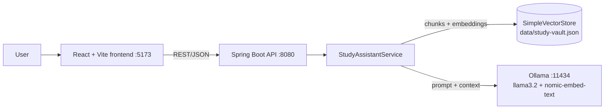

# 📚 Smart Study Assistant

An AI-powered study assistant that lets you **upload your own notes and textbooks, chat with them, and generate quizzes from them** — all running locally using a **Retrieval-Augmented Generation (RAG)** pipeline.

Built with **Java 17, Spring Boot 3, Spring AI, Ollama** (local LLM) and a **React + Vite** frontend. No cloud API keys required, and your study material never leaves your machine.

---

## ✨ Features

- **Upload study material** – `.txt`, `.md`, `.csv`, `.json` and `.pdf` files (up to 10 MB each)
- **Chat with your documents** – ask questions and get answers grounded in your uploaded content, with source filenames shown
- **Quiz generation** – generate multiple-choice quizzes on any topic from your material, answer them in the UI and get scored
- **Document management** – list and delete uploaded documents (deleting also removes their vectors)
- **Persistent storage** – the vector store and document list are saved to disk and reloaded on restart
- **100% local** – chat and embedding models run through [Ollama](https://ollama.com)
- **Clean error handling** – backend errors are returned as `{ "message": "..." }` and displayed in the UI

---

## 🏗️ Architecture



### How the RAG pipeline works

**Ingestion (upload)**
1. The file's text is extracted (UTF-8 for text files, Apache PDFBox for PDFs).
2. `TokenTextSplitter` splits the text into chunks.
3. Each chunk is embedded with `nomic-embed-text` and stored in a `SimpleVectorStore`, tagged with its filename and document ID.
4. The vector store is saved to `data/study-vault.json` and the document list to `data/documents.json`.

**Question answering**
1. The question is embedded and the **top 3** most similar chunks are retrieved.
2. The chunks are inserted into the prompt as context.
3. `llama3.2` answers using only that context (or says it doesn't have enough information).
4. The response includes the answer and the distinct source filenames.

**Quiz generation**
1. The **top 5** chunks for the chosen topic are retrieved.
2. The model is asked to return a JSON array of questions with options and the correct answer.
3. Spring AI parses the JSON into `QuizResponse` objects; the UI scores your answers.

---

## 🧰 Tech Stack

| Layer | Technology |
|---|---|
| Backend | Java 17, Spring Boot 3.4.5, Spring Web, Lombok |
| AI / RAG | Spring AI 1.0.0, `SimpleVectorStore`, `TokenTextSplitter` |
| LLM & embeddings | Ollama – `llama3.2` (chat), `nomic-embed-text` (embeddings) |
| PDF parsing | Apache PDFBox 3 |
| Frontend | React 18, Vite 5, React Router 6, Axios, lucide-react |
| Build | Maven, npm |

---

## 📁 Project Structure

```
smart-study-assistant/
├── pom.xml
├── README.md
├── run-backend.sh / run-backend.bat
├── run-frontend.sh / run-frontend.bat
├── src/main/
│   ├── java/com/study/assistant/
│   │   ├── StudyAssistantApplication.java
│   │   ├── config/VectorStoreConfig.java          # SimpleVectorStore bean + load from disk
│   │   ├── controller/
│   │   │   ├── StudyController.java               # REST endpoints
│   │   │   └── GlobalExceptionHandler.java        # {"message": "..."} errors
│   │   ├── service/StudyAssistantService.java     # RAG engine
│   │   └── dto/                                   # Request/response objects
│   └── resources/application.properties
└── frontend/
    ├── package.json, vite.config.js, index.html
    ├── .env.example
    └── src/
        ├── main.jsx, App.jsx
        ├── api/ (client.js, studyApi.js)
        ├── components/Layout.jsx
        ├── pages/ (Dashboard, StudyChat, Quiz, Documents)
        └── styles/global.css
```

---

## ✅ Prerequisites

- **JDK 17+**
- **Maven 3.9+**
- **Node.js 18+** and npm
- **[Ollama](https://ollama.com/download)** installed and running

---

## 🚀 Getting Started

### 1. Clone the repository
```bash
git clone https://github.com/<your-username>/smart-study-assistant.git
cd smart-study-assistant
```

### 2. Start Ollama and pull the models
```bash
ollama pull llama3.2
ollama pull nomic-embed-text
```
> The backend is also configured to pull missing models automatically on first start, but this can take several minutes. Pulling them up front is faster to debug.

### 3. Run the backend (port 8080)
```bash
./run-backend.sh        # Windows: run-backend.bat
# or directly:
mvn spring-boot:run
```

### 4. Run the frontend (port 5173)
```bash
./run-frontend.sh       # Windows: run-frontend.bat
# or directly:
cd frontend
npm install
npm run dev
```

### 5. Open the app
Go to **http://localhost:5173**, upload a document on the Dashboard, then use **Chat** or **Quiz**.

---

## ⚙️ Configuration

### Backend – `src/main/resources/application.properties`

| Property | Default | Description |
|---|---|---|
| `server.port` | `8080` | API port |
| `spring.servlet.multipart.max-file-size` | `10MB` | Max upload size |
| `spring.ai.ollama.base-url` | `http://localhost:11434` | Ollama address |
| `spring.ai.ollama.chat.options.model` | `llama3.2` | Chat model |
| `spring.ai.ollama.chat.options.temperature` | `0.2` | Lower = more factual |
| `spring.ai.ollama.embedding.options.model` | `nomic-embed-text` | Embedding model |
| `spring.ai.ollama.init.pull-model-strategy` | `when_missing` | Auto-download missing models |
| `study.data-dir` | `./data` | Where the vector store and document list are saved |

### Frontend – `frontend/.env`
```env
VITE_API_BASE_URL=http://localhost:8080
```
Copy `frontend/.env.example` to `frontend/.env` if it doesn't exist.

> **Changing the embedding model?** Delete the `data/` folder first — vectors from different models are not compatible.

---

## 📡 API Reference

Base path: `/api/v1/study`

| Method | Endpoint | Body | Description |
|---|---|---|---|
| `POST` | `/upload` | multipart `file` | Ingest a document |
| `POST` | `/ask` | `{ "question": "..." }` | Ask a question |
| `POST` | `/generate-quiz` | `{ "targetTopic": "...", "numberOfQuestions": 5 }` | Generate a quiz |
| `GET` | `/documents` | – | List uploaded documents |
| `DELETE` | `/documents/{id}` | – | Delete a document and its vectors |

### Examples
```bash
# Upload
curl -F "file=@notes.pdf" http://localhost:8080/api/v1/study/upload

# Ask
curl -X POST http://localhost:8080/api/v1/study/ask \
  -H "Content-Type: application/json" \
  -d '{"question":"What is photosynthesis?"}'
```

Response:
```json
{ "answer": "Photosynthesis is ...", "sources": ["notes.pdf"] }
```

Quiz response:
```json
[
  {
    "questionNumber": 1,
    "questionText": "Where does photosynthesis occur?",
    "multipleChoiceOptions": ["Chloroplasts", "Mitochondria", "Nucleus", "Ribosomes"],
    "correctAnswer": "Chloroplasts"
  }
]
```

Errors are returned as `{ "message": "..." }` with HTTP 400 (bad input) or 500 (server/Ollama problem).

---

## 🛠️ Troubleshooting

| Problem | Likely cause / fix |
|---|---|
| `Connection refused` to `localhost:11434` | Ollama isn't running – start it with `ollama serve` |
| First request is very slow | Model is loading into memory; later requests are faster |
| Upload times out | Embedding large files on CPU is slow; try a smaller file |
| Quiz fails with a parse error | Small local models sometimes return invalid JSON – click Generate again, or use a larger model |
| "No study material found" | Upload a document before generating a quiz |
| Odd results after changing embedding model | Delete the `data/` folder and re-upload your files |
| CORS errors | Make sure `VITE_API_BASE_URL` matches the backend address |

---

## ⚠️ Limitations

- `SimpleVectorStore` keeps all vectors in memory and uses brute-force search – fine for personal study use, not for very large corpora.
- Scanned (image-only) PDFs contain no extractable text; OCR is not included.
- Answer quality depends on the local model you choose.
- No authentication; `@CrossOrigin("*")` is intended for local development only.

---

## 🗺️ Roadmap

- [ ] Swap `SimpleVectorStore` for PGVector / Chroma
- [ ] Streaming chat responses
- [ ] `.docx` and `.pptx` support
- [ ] Conversation memory across questions
- [ ] User accounts and per-user document libraries
- [ ] Docker Compose setup (backend + frontend + Ollama)

---

## 🤝 Contributing

Contributions are welcome. Fork the repo, create a feature branch, commit your changes and open a pull request.
